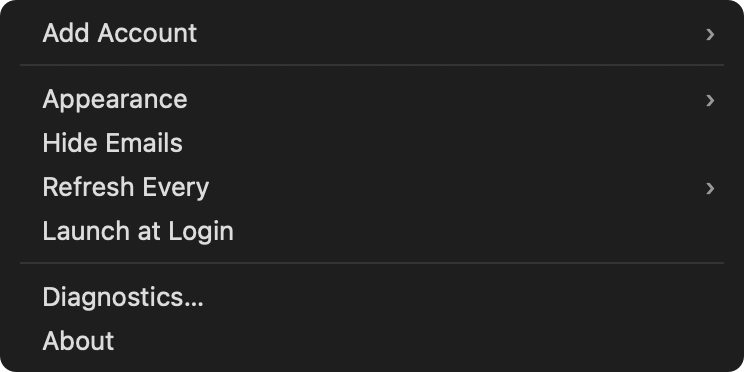

<p align="center">
  
</p>

<h1 align="center">Refill</h1>

<p align="center">
  <i>A native macOS menubar app that shows when your AI coding limits refill, and switches accounts in a click.</i>
</p>

<p align="center">
  
  
  
  
</p>

<p align="center">
  <picture>
    <source media="(prefers-color-scheme: dark)" srcset="docs/assets/codexpill-menu-dark.png">
    
  </picture>
</p>

Refill was called CodexPill before this release.

## What It Does

- See Codex, Claude Code and Cursor usage limits and when they reset.
- Switch between saved accounts for each tool.
- Add accounts without disrupting your current session.
- Track local Codex token usage history from the menu bar.
- Stay local-first: no cloud sync, no hidden browser automation, no account data upload.

Claude Code and Cursor are optional. Refill reads them only after you connect
them from `Settings › Add Account`.

## New In Beta 2

- Optional Token Usage card for this Mac, with daily bars, heat strip and
  sparkline chart styles.
- Local session history scanning with an incremental cache, so refreshes reuse
  unchanged session files instead of rescanning everything.
- Swift 6 language mode for the app and tests.
- CI coverage for pull requests and `main`.

## Install

Install with Homebrew:

```bash
brew install --cask raphhgg/tap/codexpill
```

The cask still uses the old name. It will be renamed in a later release.

Or download the latest zip from
[GitHub Releases](https://github.com/raphhgg/CodexPill/releases).

## Build From Source

Prerequisites:

- macOS with Xcode command line tools installed.
- Tuist installed locally.
- Codex installed and signed in on this Mac.

Build and run:

```bash
tuist generate --no-open
make build
./scripts/run_menubar.sh
```

For release maintainers, the signed public beta artifact is produced with:

```bash
make package-release
```

That command requires local Developer ID signing and notarization setup before
it creates a public release artifact. See [Development](docs/DEVELOPMENT.md)
for maintainer packaging details.

## Prerequisite

Codex must already be installed and signed in on your Mac, either through the
Codex app, the Codex CLI or both.

Token Usage is optional and local to this Mac. It reads local Codex session
history, stores derived aggregate buckets, and does not upload prompt content,
session rows or auth data.

## Screenshots

| Add Account | Codex Side Menu |
| --- | --- |
|  |  |

| Settings |
| --- |
|  |

## Local-First

Refill works with Codex, Claude Code and Cursor state on your Mac. It does not
run a cloud service.

Saved Codex accounts stay on your Mac under
`~/Library/Application Support/CodexPill`. Saved Claude Code and Cursor sign-ins
stay in your login Keychain. They contain authentication material, so treat them
like credentials. The folder and Keychain items keep the old CodexPill name, so
your saved accounts and settings carry over.

Refill does not use browser cookies, hidden browser windows, Full Disk
Access, Screen Recording or Accessibility permissions for normal use.

## Product Docs

- [Product overview](docs/PRODUCT.md)
- [Feature contracts](docs/features/README.md)
- [Privacy and data handling](docs/PRIVACY.md)
- [Beta testing guide](docs/BETA_TESTING.md)

## Project Policies

- [Changelog](CHANGELOG.md)
- [MIT license](LICENSE)
- [Security policy](SECURITY.md)
