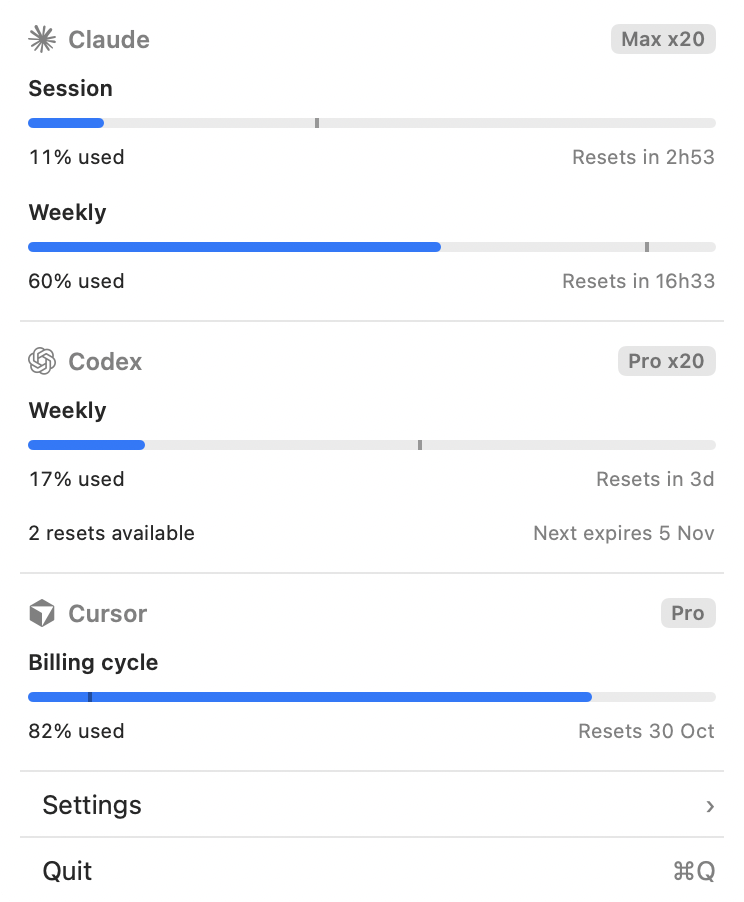
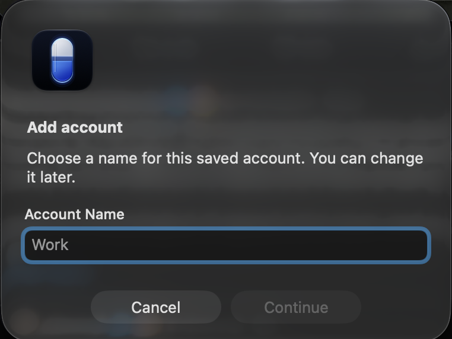
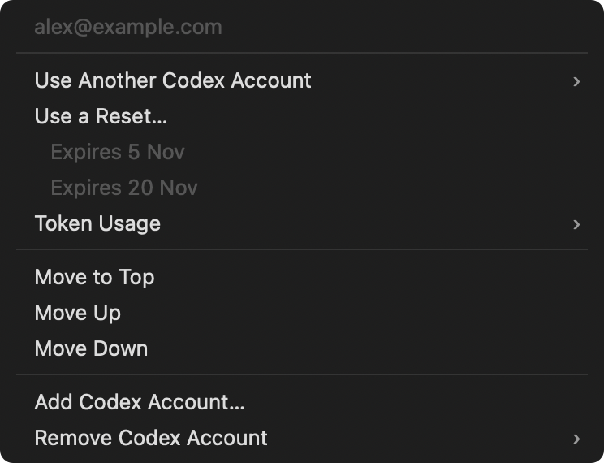

<p align="center">
  
</p>

<h1 align="center">rusage</h1>

<p align="center">
  <i>A native macOS menubar app that shows when your AI coding limits refill, and switches accounts in a click.</i>
</p>

<p align="center">
  
  
  
  
</p>

<p align="center">
  <picture>
    <source media="(prefers-color-scheme: dark)" srcset="docs/assets/rusage-menu-dark.png">
    
  </picture>
</p>

rusage was called CodexPill before this release. See
[Upgrading From CodexPill](#upgrading-from-codexpill).

## What It Does

- See Codex, Claude Code and Cursor usage limits and when they reset.
- Switch between saved Codex accounts.
- Add Codex accounts without disrupting your current session.
- Track local Codex token usage history from the menu bar.
- Stay local-first: no cloud sync, no hidden browser automation, no account data upload.

Claude Code and Cursor are optional. rusage reads the account each one is signed
in to, only after you turn it on in `Settings › Tools`.

## What's New

- Claude Code and Cursor: see their limits next to Codex.
- One card per tool, with account actions in side menus and the app's own
  items right under the cards.
- Codex reset credits: see how many you have and use one from the Codex menu.
- A new name and a new icon: a glass lens half full of cobalt, the pair to
  rbar's.
- Remote Hosts and Notifications are gone.

See the [Changelog](CHANGELOG.md) for earlier releases.

## Install

Install with Homebrew:

```bash
brew install --cask raphhgg/tap/codexpill
```

The cask still uses the old name. It will be renamed in a later release.

Or download the latest zip from
[GitHub Releases](https://github.com/raphhgg/rusage/releases).

## Build From Source

Prerequisites:

- macOS with Xcode command line tools installed.
- Tuist installed locally.
- Codex, Claude Code or Cursor installed and signed in on this Mac.

Build and run:

```bash
tuist generate --no-open
make build
./scripts/run_menubar.sh
```

For release maintainers, the signed public beta artifact is produced with:

```bash
make package-release
```

That command requires local Developer ID signing and notarization setup before
it creates a public release artifact. See [Development](docs/DEVELOPMENT.md)
for maintainer packaging details.

## Prerequisite

Install and sign in to at least one tool on your Mac: Codex (the app, the CLI or
both), Claude Code or Cursor. rusage shows a Codex card once you save a Codex account. Claude Code and
Cursor appear once you turn them on in `Settings › Tools`.

Token Usage is optional and local to this Mac. It reads local Codex session
history, stores derived aggregate buckets, and does not upload prompt content,
session rows or auth data.

## Screenshots

| Add Account | Codex Side Menu |
| --- | --- |
|  |  |

## Local-First

rusage works with Codex, Claude Code and Cursor state on your Mac. It does not
run a cloud service.

Saved Codex accounts stay on your Mac under
`~/Library/Application Support/rusage`. They contain authentication material, so
treat them like credentials. rusage only reads Claude Code's and Cursor's own
sign-ins and never writes them.

rusage does not use browser cookies, hidden browser windows, Full Disk
Access, Screen Recording or Accessibility permissions for normal use.

## Upgrading From CodexPill

rusage is a new app to macOS, with its own bundle ID. Quit and delete
`CodexPill.app` first. On its first launch rusage copies CodexPill's saved
accounts, settings and Keychain items, unless rusage already has accounts of its
own. macOS may ask once per Keychain item whether rusage can read it. Turn
Launch at Login back on if you used it. CodexPill's copies stay on this Mac as a
backup. [Uninstall And Reset](docs/UNINSTALL_RESET.md#leftovers-from-codexpill)
shows how to remove them.

## Product Docs

- [Product overview](docs/PRODUCT.md)
- [Feature contracts](docs/features/README.md)
- [Privacy and data handling](docs/PRIVACY.md)
- [Beta testing guide](docs/BETA_TESTING.md)

## Project Policies

- [Changelog](CHANGELOG.md)
- [MIT license](LICENSE)
- [Security policy](SECURITY.md)
